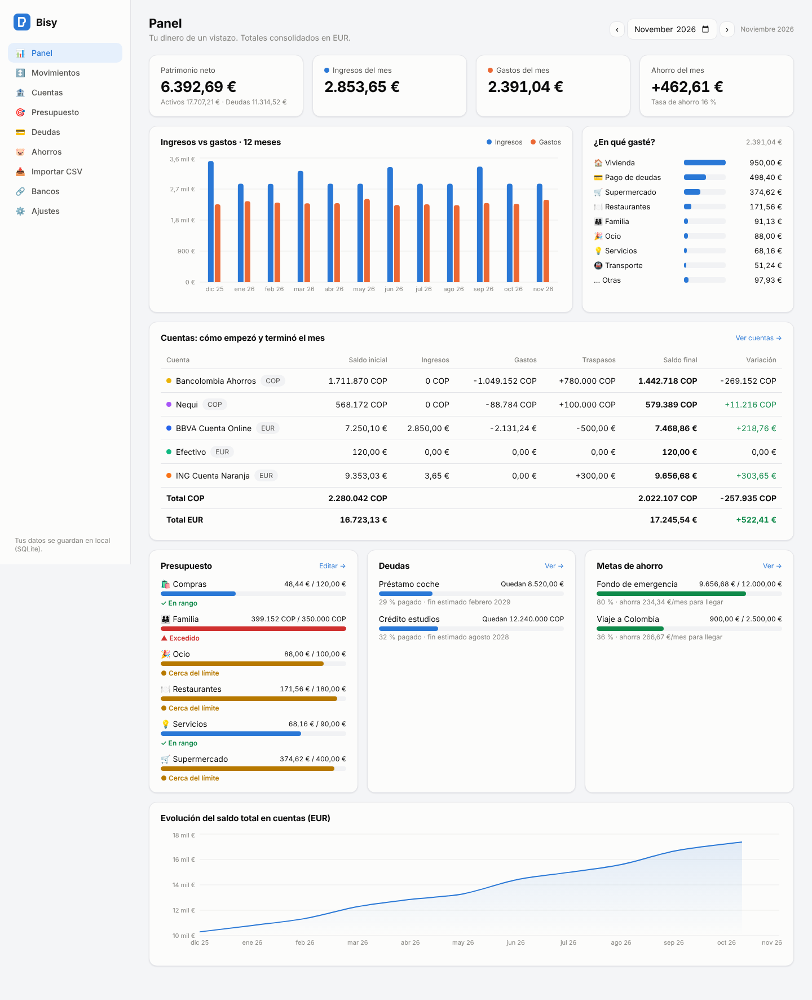

# Bisy 💸

Aplicación personal para controlar tus finanzas del día a día: cuentas en varias monedas (EUR, COP…), movimientos, traspasos entre cuentas, presupuesto mensual, deudas y ahorros, con un panel visual en React y conexión con bancos para importar movimientos sin teclearlos.



## Qué hace

| Necesidad | Dónde |
|---|---|
| ¿Con cuánto empezó y terminó el mes cada cuenta? | **Panel** → tabla de cuentas, y **Cuentas → Mes a mes** |
| ¿En qué gasté y cuánto ingresé? | **Panel** (por categoría y 12 meses) y **Movimientos** con filtros |
| Cuentas en euros y pesos colombianos | Cada cuenta tiene su moneda; los totales se consolidan en EUR con los **tipos de cambio** (Ajustes) |
| Pasar dinero entre cuentas (también EUR → COP) | **Movimientos → Nuevo → Traspaso**, con importe recibido y comisión |
| Presupuesto mensual por categoría | **Presupuesto** (se puede copiar del mes anterior; convierte gastos de otras monedas) |
| Deudas y cómo bajan con cada pago | **Deudas**: capital vs intereses, gráfica y fecha estimada de fin |
| Ahorros | **Ahorros**: metas vinculadas a una cuenta o con aportaciones manuales |
| Que los movimientos lleguen solos | **Bancos** (PSD2 vía Enable Banking) o **Importar CSV** como alternativa |

## Versión web (GitHub Pages)

👉 **https://charliecobo.github.io/bisy/**

Se publica sola con cada cambio en `main`. En esta versión **todo funciona dentro del navegador**: la misma lógica del servidor corre con SQLite en WebAssembly (sql.js) y los datos se guardan en IndexedDB **de ese dispositivo**. La página es pública, pero tus datos no salen de tu navegador.

- **Copias de seguridad:** en *Ajustes → Tus datos* puedes descargar y restaurar una copia `.db`. Sirve también para pasar los datos de un dispositivo a otro, y es compatible con la versión de servidor.
- **iPad/iPhone:** añádela a la pantalla de inicio (*Compartir → Añadir a pantalla de inicio*). Si no, Safari puede borrar los datos de webs que no visitas en 7 días.
- **Sin conexión bancaria:** necesita una clave privada que no puede ir en una web pública. Usa *Importar CSV* o ejecuta la versión de servidor.
- Para probarla en local: `npm run dev:pages -w web`.

## Puesta en marcha (versión completa con servidor)

Requisitos: **Node.js 22.13 o superior** (usa el SQLite integrado en Node, sin instalar base de datos).

```bash
git clone https://github.com/CharlieCobo/bisy.git
cd bisy
npm install
cp .env.example .env      # opcional: solo hace falta para la conexión bancaria
npm run dev               # API en :4000 y web en http://localhost:5173
```

Tus datos se guardan en `server/data/bisy.db` (ignorado por git). Haz copia de ese archivo de vez en cuando.

### Probar con datos de ejemplo

```bash
npm run seed                                            # crea server/data/bisy-demo.db
DB_PATH=./server/data/bisy-demo.db npm run dev
```

### Primeros pasos con tus datos

1. **Ajustes → Tipos de cambio**: pulsa *Actualizar hoy* (o añade 1 EUR = X COP a mano).
2. **Cuentas**: crea tus cuentas con su moneda y el saldo que tenían en una fecha concreta.
3. Importa movimientos desde **Bancos** o **Importar CSV**, o añádelos a mano.
4. **Ajustes → Reglas**: crea reglas (p. ej. "mercadona" → Supermercado) para que lo importado se categorice solo.
5. **Movimientos**: si importas una transferencia entre tus cuentas, selecciona la salida y la entrada y pulsa *Marcar como traspaso*, así no cuenta como gasto ni ingreso.
6. **Presupuesto**, **Deudas** y **Ahorros**: define tus límites y objetivos.

### Producción (un solo proceso)

```bash
npm run build
npm start                 # sirve API y web en http://localhost:4000
```

## Conexión bancaria

Resumen: para bancos **españoles** se usa [Enable Banking](https://enablebanking.com), gratis para tus propias cuentas. Para **Colombia** no hay hoy una opción gratuita para particulares, así que de momento va por CSV. Detalles, costes y pasos en [docs/conexion-bancaria.md](docs/conexion-bancaria.md).

## Estructura

```
server/   API REST (Express + TypeScript + node:sqlite)
  src/db.ts            esquema de la base de datos
  src/finance.ts       lógica: saldos mensuales, traspasos, deudas, metas, presupuesto, panel
  src/csv.ts           importación CSV (formatos españoles y colombianos)
  src/bank/            proveedores bancarios (Enable Banking) y sincronización
web/      React + Vite + Recharts
  src/pages/           Panel, Movimientos, Cuentas, Presupuesto, Deudas, Ahorros, Importar, Bancos, Ajustes
```

Todas las cantidades se guardan como enteros en céntimos/centavos para evitar errores de redondeo.

## Scripts

| Comando | Qué hace |
|---|---|
| `npm run dev` | API + web en modo desarrollo |
| `npm test` | Tests de la lógica financiera y del CSV |
| `npm run typecheck` | Comprobación de tipos de API y web |
| `npm run build` / `npm start` | Compilar y ejecutar en producción |
| `npm run seed` | Base de datos de ejemplo |

## Seguridad

- Bisy está pensada para ejecutarse **en tu ordenador** o en un servidor privado. No tiene login: si la publicas en internet, ponla detrás de una VPN, Tailscale o un proxy con autenticación.
- La conexión bancaria es de **solo lectura** (PSD2 AIS): no puede mover dinero.
- Nunca subas `.env`, la clave `.pem` ni la base de datos (ya están en `.gitignore`).
